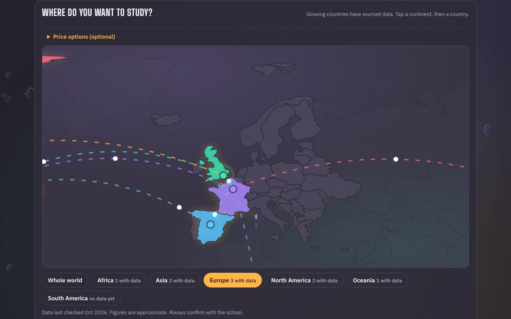
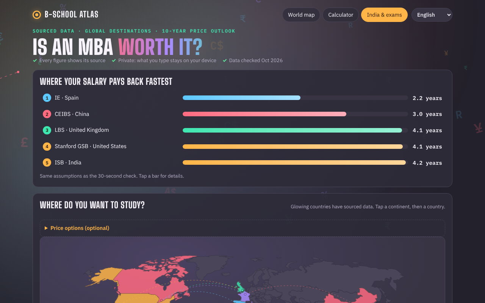
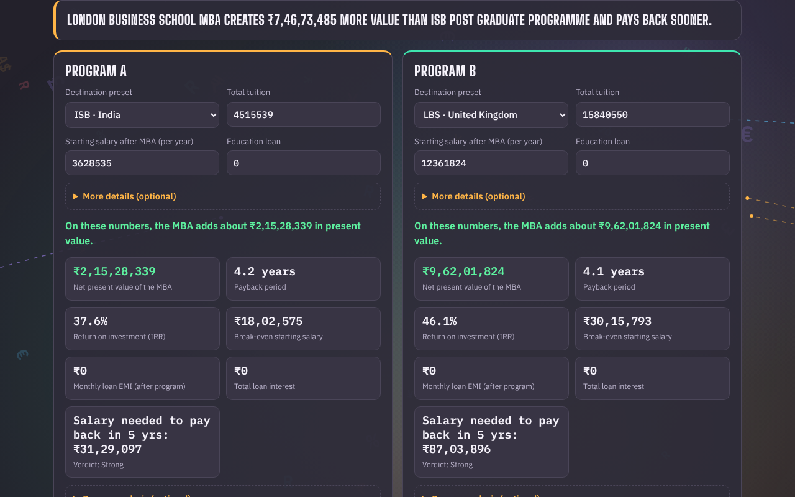

# B-School Atlas

**Is an MBA worth it?** A web app that helps MBA applicants compare destinations worldwide, check which Indian B-schools their entrance-exam score can reach, and see how many years the degree takes to pay for itself.

Built by **[Pasupuleti VedhRishi](https://www.linkedin.com/in/vedhrishi-pasupuleti)**.

**Live site:** `https://<your-github-username>.github.io/bschool-atlas/` *(replace after the first deploy)*

## What it does

| Feature | Details |
|---|---|
| World map | Pick a continent, then a country, to see sourced tuition and starting salaries for a leading programme (ISB, CEIBS, LBS, INSEAD, IE, Stanford GSB, Rotman, AGSM, UCT GSB). |
| 30-second check | Enter today's salary and a destination; get payback period, value added (NPV) and a verdict. |
| Payback ranking | Ranks every destination by how fast *your* salary pays it back. |
| India & exams | A profile finder for 51 Indian B-schools: pick your exam (CAT, XAT, NMAT, SNAP, CMAT, MAH-CET, GMAT, IELTS, TOEFL), score, category (General, EWS, OBC-NCL, SC, ST, PwD), gender, current salary and budget. See colleges within reach, those that meet your category minimum, fee, average salary and **payback for you**. Shortlist, side-by-side comparison of up to 3 colleges, a fee-vs-salary chart and a sortable table with NIRF 2025 ranks. |
| Full calculator | Two programmes side by side: tax, loan EMI and schedule, scholarship, signing bonus, risk scenarios, sensitivity table, break-even salary. |
| 10-year price outlook | Month-by-month tables of approximate fees, salaries and exchange rates to October 2036, so the numbers stay useful. |
| Seven languages | English, Hindi, Spanish, French, Portuguese, Chinese and Arabic (right-to-left). |
| Share and export | Copy or download results as a table, print or save as PDF, and a summary image for LinkedIn. |

| Map | India & exams | Calculator |
|---|---|---|
|  |  |  |

## How the numbers work
- **Cash flows:** each year compares the MBA path (no salary while studying, tuition and living costs, then the post-MBA salary minus loan repayments) with staying in the current job. Both are after a flat tax rate.
- **NPV** discounts those yearly differences. **Payback** is when the cumulative difference turns positive. **IRR** and the **break-even salary** are found by bisection.
- **Projections:** a figure reported in one month is moved to any other month with local inflation plus an adjustable extra growth rate. Exchange rates start from ECB reference rates (23 Oct 2026) and drift with each currency's inflation gap against the US dollar (relative purchasing-power parity).

Code: [`finance.js`](finance.js) (model), [`project.js`](project.js) (projections), [`app.js`](app.js) (calculator), [`map.js`](map.js) (map and home), [`india.js`](india.js) (India page), [`i18n.js`](i18n.js) (translations), [`motion.js`](motion.js) (animation).

## Data and its limits
- Country data: [`data/countries.js`](data/countries.js). India data: [`data/india.js`](data/india.js). Every figure carries its source and the month it refers to, and figures found only on blogs were left out.
- Fees and average salaries are sourced for 27 colleges; category minimums for six IIMs (official-style qualifying minimums; final calls are higher) and gender bands for XLRI. Missing figures show as not yet sourced.
- Entrance-exam cut-offs are approximate General-category figures from admissions publishers. They change every year and depend on category, academics, work experience and interviews.
- Some NIRF 2025 ranks could not be confirmed and are left blank rather than guessed.
- Not financial advice. Data last checked October 2026.

## Tech
- Plain HTML, CSS and JavaScript. No framework, no build step, no backend, no tracking.
- 27 automated tests (`node --test`) covering the finance maths, projections and data integrity.
- GitHub Actions runs the tests and deploys to GitHub Pages on every push to `main`.
- World map from [Natural Earth](https://www.naturalearthdata.com/) (public domain) via `world-atlas`; `npm install && npm run build:map` regenerates `data/world.js`.

## Run locally
Open `index.html` in a browser, or serve the folder (`python3 -m http.server`). Run the tests with `node --test` (Node 18+).

## Updating the data
Edit the figure, its `asOf` month and its source in `data/countries.js` or `data/india.js`, update `checked`, run `node --test`, and push. The site redeploys automatically.

## License
MIT © [Pasupuleti VedhRishi](https://www.linkedin.com/in/vedhrishi-pasupuleti)
